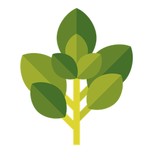
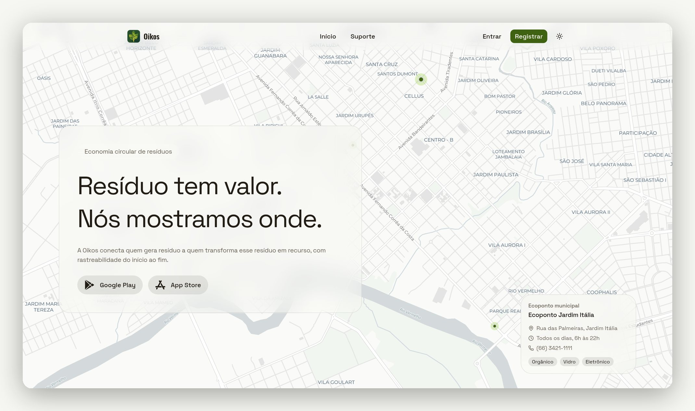
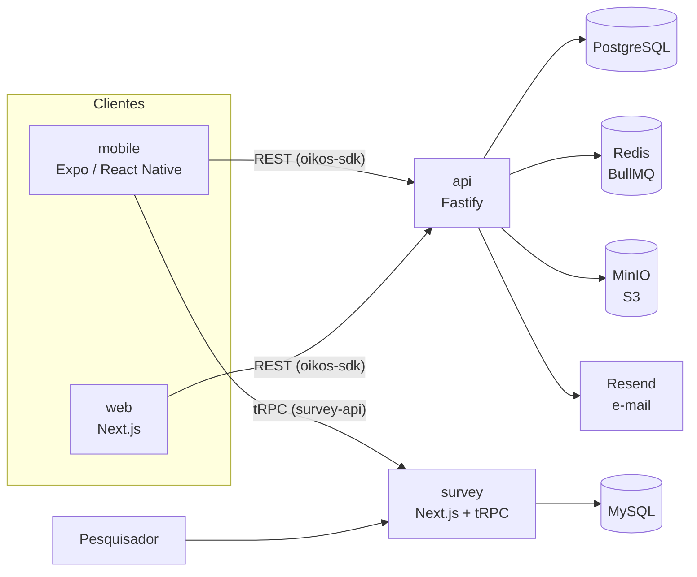

<p align="center">
  
</p>

<h1 align="center">Oikos Web</h1>

<p align="center">
  <a href="https://github.com/oikos-circular-environment/web/actions/workflows/ci.yml"></a>
  
  
  
  
</p>

<p align="center">
  <strong>Resíduo tem valor. Nós mostramos onde.<br>
  Site institucional e painel web da plataforma Oikos de economia circular de resíduos.</strong>
</p>

<p align="center">
  <picture>
    <source media="(prefers-color-scheme: dark)" srcset=".github/assets/web-hero-dark.jpg">
    
  </picture>
</p>

<p align="center">
  <a href="https://oikos.company">oikos.company</a> ·
  <a href="https://apps.apple.com/br/app/oikos-economia-circular/id6786017565">App Store</a> ·
  <a href="https://play.google.com/store/apps/details?id=com.oikos">Google Play</a>
</p>

## Sobre o Oikos

O Oikos é uma plataforma de economia circular de resíduos sólidos. Ela conecta quem gera resíduo (moradores, empresas e órgãos públicos) a quem transforma esse resíduo em recurso: cooperativas, recicladoras, ecopontos e coletores.

O produto tem três frentes:

- **Pontos de coleta e mercado.** Mapa de empresas e ecopontos com os resíduos que cada um aceita, horários de funcionamento e preço pago por quilo.
- **Denúncias ambientais.** Registro de descarte irregular com foto, vídeo e localização. A comunidade vota se a denúncia foi resolvida e a moderação acompanha o andamento.
- **Modo pesquisa.** Teste de usabilidade aplicado dentro do próprio aplicativo, usado na avaliação da dissertação de mestrado que originou o projeto.

Este repositório é a face web do Oikos. A parte pública apresenta o projeto e direciona para as lojas. O painel autenticado é onde organizações cuidam do perfil, das empresas, do mercado e das denúncias, e onde a moderação trabalha.

## Ecossistema

| Repositório | Papel | Stack principal |
|---|---|---|
| [api](https://github.com/oikos-circular-environment/api) | API REST, regras de negócio, autenticação, filas e armazenamento | Fastify, Prisma, PostgreSQL, Redis, MinIO |
| **web** (este) | Site institucional e painel web para organizações e moderação | Next.js, Tailwind CSS, MapLibre |
| [mobile](https://github.com/oikos-circular-environment/mobile) | Aplicativo iOS e Android | Expo, React Native |
| [survey](https://github.com/oikos-circular-environment/survey) | Instrumento e painel do teste de usabilidade | Next.js, tRPC, Drizzle, MySQL |
| devops (privado) | Infraestrutura, deploy e observabilidade | Terraform, Docker Compose, Nginx, Grafana |

## Arquitetura



O painel fala com a API pelo pacote `@oikos-circular-environment/oikos-sdk`, gerado a partir da especificação OpenAPI da API. A autenticação usa o cliente do Better Auth, o mesmo provedor que a API expõe.

## Stack

| Área | Tecnologia |
|---|---|
| Framework | Next.js 16 (App Router) com React 19 |
| Estilo | Tailwind CSS 4, componentes shadcn sobre Radix e Base UI |
| Mapas | MapLibre GL |
| Dados | TanStack Query e Zustand |
| Formulários | React Hook Form com Zod |
| Autenticação | Better Auth |
| Anti-bot | Cloudflare Turnstile nos formulários públicos |
| Observabilidade | OpenTelemetry |
| Testes | Playwright com uma API falsa (`e2e/fake-api-server.mjs`) |
| Qualidade | Biome, Knip, Lighthouse CI e Lefthook |

## Estrutura

```
src/
  app/
    (public)/                  página inicial e bio
    (public)/(institutional)/  login, registro, suporte, termos, privacidade, design system
    (dashboard)/dashboard/     painel: denúncias, empresas, mercado, moderação, organizações, perfil e conta
  components/                  componentes de interface
  contexts/ hooks/ stores/     estado e lógica de tela
  libs/                        cliente da API, autenticação e utilitários
  content/                     termos de uso e política de privacidade
e2e/                           testes Playwright
DESIGN.md                      tokens e regras do design system
```

## Rodando localmente

Pré-requisitos: Node.js 24 e uma instância da [api](https://github.com/oikos-circular-environment/api) rodando.

O SDK da API é publicado no GitHub Packages, que exige autenticação mesmo para leitura. Gere um token do GitHub com o escopo `read:packages` e exporte como `GH_TOKEN_PERSONAL_TOKEN` antes de instalar as dependências.

```bash
cp .env.example .env
export GH_TOKEN_PERSONAL_TOKEN=<seu-token>
npm install
npm run dev
```

O painel sobe em `http://localhost:3000`. Aponte `NEXT_PUBLIC_API_URL` no `.env` para a API local (`http://localhost:3333`). As chaves de Turnstile do `.env.example` são as chaves de teste da Cloudflare e funcionam em desenvolvimento.

## Testes e qualidade

```bash
npm run lint        # Biome
npm run knip        # código e dependências sem uso
npm run test:e2e    # Playwright
npm run lighthouse  # Lighthouse CI
```

## Colaboração

Contribuições são bem-vindas. O fluxo é o mesmo em todos os repositórios do Oikos:

1. **Comece por uma issue.** Descreva o problema ou a proposta antes de abrir código.
2. **Crie a branch a partir de `development`**, com o nome `<número-da-issue>-<descrição-curta>`, por exemplo `142-filtro-por-residuo`. Quem não faz parte da organização trabalha a partir de um fork.
3. **Faça commits pequenos** no padrão [Conventional Commits](https://www.conventionalcommits.org/pt-br/), como `feat(dashboard): ...` ou `fix(auth): ...`.
4. **Abra o pull request para `development`.** A descrição tem duas seções: `## Contexto` e `## O que foi feito`. O que ficou pendente vira uma nova issue.
5. **`production` só recebe código vindo de `development`**, também por pull request.

Os hooks do Lefthook rodam lint e formatação no `pre-commit` e bloqueiam commit e push direto em `development` e `production`. Não pule os hooks com `--no-verify`.

## Licença

O código é disponibilizado sob a [PolyForm Noncommercial 1.0.0](LICENSE). Você pode estudar, usar, modificar e redistribuir o Oikos para fins não comerciais: uso pessoal, pesquisa, ensino e uso por instituições de ensino, organizações beneficentes, de pesquisa ou de proteção ambiental e órgãos públicos. Ao redistribuir, mantenha o arquivo `LICENSE` com o aviso de copyright.

Uso comercial, como vender o software, oferecê-lo como serviço pago ou usá-lo como base de um produto, exige uma licença comercial à parte com o titular. Para tratar disso, escreva para christian.cesar@oikos.company.

Por restringir o uso comercial, esta licença não é open source na definição da OSI. O código é aberto para leitura, estudo e uso não comercial.

Ao enviar uma contribuição, você concorda que ela seja distribuída sob esta mesma licença e possa ser incluída nas licenças comerciais do projeto, com o crédito de autoria preservado.

O Oikos é registrado no INPI como programa de computador, processo BR 51 2026 008392-3.
