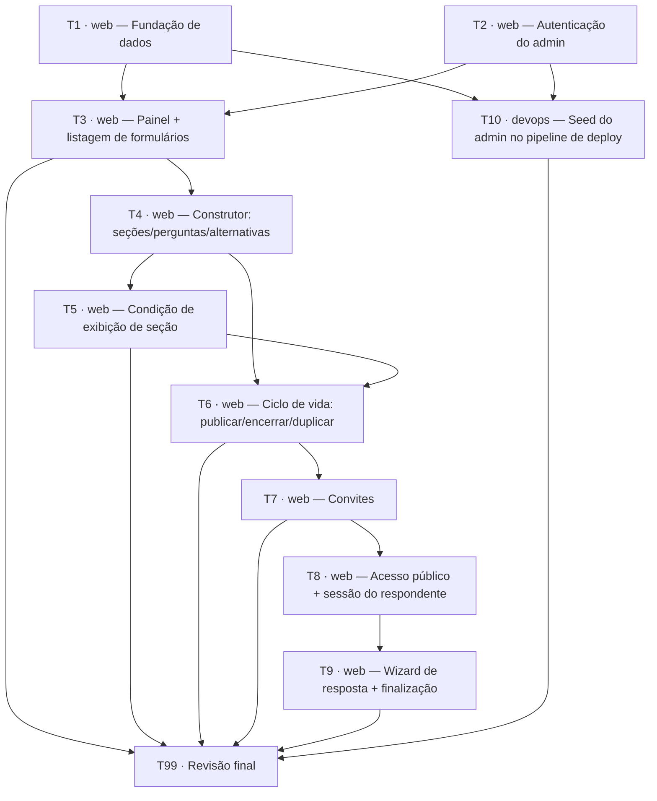

# Sistema de Pesquisas de Usabilidade — Ticket Breakdown

Baseado em `00-epic-brief.md`, `01-core-flows.md` e `02-tech-plan.md`. Cada ticket vive em [`tickets/`](./tickets/), com escopo, referências de spec e checklist próprios. Ao final de todas, rodar [`tickets/99-revisao-final.md`](./tickets/99-revisao-final.md) — roda a suíte Cypress completa e confere contra o critério de sucesso do Epic Brief.

## Dependências

T1 e T2 são independentes entre si — podem rodar em paralelo.

## Tickets

| # | Título | Escopo | Dependências |
|---|---|---|---|
| [T1](./tickets/01-fundacao-dados.md) | `web` — Fundação de dados | Schema Prisma completo, Postgres local via Docker Compose, Prisma Client singleton, zod | — |
| [T2](./tickets/02-autenticacao.md) | `web` — Autenticação do admin | Better Auth (schema, instância, client, middleware), login/logout, proteção de `/painel/**` | — |
| [T3](./tickets/03-painel-listagem.md) | `web` — Painel + listagem de formulários | Sidebar, listagem com estado, criar/renomear/excluir formulário (rascunho) | T1, T2 |
| [T4](./tickets/04-construtor.md) | `web` — Construtor: seções/perguntas/alternativas | CRUD de seção/pergunta/alternativa, reordenação via `@dnd-kit`, salvamento explícito | T3 |
| [T5](./tickets/05-condicao-exibicao.md) | `web` — Condição de exibição de seção | UI de configuração da condição, integridade via `onDelete: Restrict` + mensagens amigáveis | T4 |
| [T6](./tickets/06-ciclo-vida-formulario.md) | `web` — Ciclo de vida: publicar/encerrar/duplicar | Transições de estado só pra frente, duplicação com remapeamento de condições | T4, T5 |
| [T7](./tickets/07-convites.md) | `web` — Convites | Gerar/revogar/listar convites, código de 6 dígitos, status derivado (incl. expirado) | T6 |
| [T8](./tickets/08-acesso-publico.md) | `web` — Acesso público + sessão do respondente | Gate de código, cookie `iron-session`, avaliador de condição (função pura) | T7 |
| [T9](./tickets/09-wizard-resposta.md) | `web` — Wizard de resposta + finalização | Wizard por seção, salvamento de rascunho, finalização atômica | T8 |
| [T10](./tickets/10-seed-admin-devops.md) | `devops` — Seed do admin no pipeline de deploy | Script de seed idempotente + step no CI/CD do repo `devops` | T1, T2 |
| [T99](./tickets/99-revisao-final.md) | Revisão final | Suíte Cypress completa + testes unitários rodando; checklist cruzado contra Core Flows | Todas |

## Refinamento

Agrupamento por fluxo/camada, granularidade de "story" por ticket. Ajustar aqui e nos arquivos individuais se algo precisar ser combinado (ex: T5 dentro de T4), dividido, ou reordenado.
